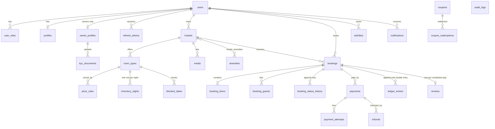

# Data model (ERD)

Source of truth: `backend/prisma/schema.prisma` plus hand-written SQL in `prisma/migrations/*_db_extras`.
Money = integer paise. Stay dates = `date` in the hostel's timezone. Ids = UUIDv7.

## Database-enforced invariants (db_extras migration)
| Guarantee | Mechanism |
|---|---|
| No overbooking | `inventory_nights` CHECK `held_units + booked_units + blocked_units <= total_units`; holds use a conditional `UPDATE ... WHERE held+booked+blocked+n <= total` (`blocked_units` = owner calendar blocks) |
| Booking money adds up | CHECK `total = subtotal + tax + service_fee - discount`, `nights = check_out - check_in` |
| Audit tamper evidence | `audit_logs` BEFORE INSERT trigger computes `prev_hash`/`hash` (sha256 chain, advisory-lock serialised); `audit_verify_chain()` reports broken links |
| Append-only history | Triggers reject UPDATE/DELETE/TRUNCATE on `audit_logs`, `ledger_entries`, `booking_status_history` |
| Data hygiene | emails lower-case, coupon codes upper-case, rating ranges, lat/lng ranges, coupon discount shape |
| Reviews are verified | `reviews` BEFORE INSERT trigger: the booking must exist, be `COMPLETED`, and belong to the same guest and hostel; one review per booking (unique) |
| Coupons are sane | CHECK per-user limit >= 1, usage limit >= 1, max discount > 0, minimum >= 0, `used_count <= usage_limit` |
| Search | GiST `ll_to_earth(lat,lng)` for radius search; trigram GIN on name/city/locality |

Deviation from the original plan: `addresses` is embedded in `hostels` (one address per property).
