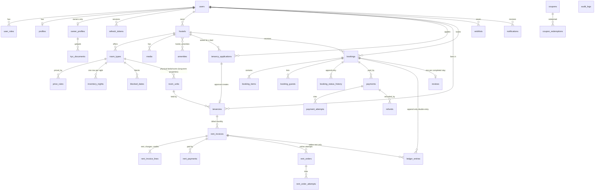

# Data model (ERD)

Source of truth: `backend/prisma/schema.prisma` plus hand-written SQL in `prisma/migrations/*_db_extras`.
Money = integer paise. Stay dates = `date` in the hostel's timezone. Ids = UUIDv7.



## Database-enforced invariants (db_extras migration)
| Guarantee | Mechanism |
|---|---|
| No overbooking | `inventory_nights` CHECK `held_units + booked_units + blocked_units <= total_units`; holds use a conditional `UPDATE ... WHERE held+booked+blocked+n <= total` (`blocked_units` = owner calendar blocks) |
| Booking money adds up | CHECK `total = subtotal + tax + service_fee - discount`, `nights = check_out - check_in` |
| Audit tamper evidence | `audit_logs` BEFORE INSERT trigger computes `prev_hash`/`hash` (sha256 chain, advisory-lock serialised); `audit_verify_chain()` reports broken links |
| Append-only history | Triggers reject UPDATE/DELETE/TRUNCATE on `audit_logs`, `ledger_entries`, `booking_status_history` |
| Data hygiene | emails lower-case, coupon codes upper-case, rating ranges, lat/lng ranges, coupon discount shape |
| Reviews are verified | `reviews` BEFORE INSERT trigger: the booking must exist, be `COMPLETED`, and belong to the same guest and hostel; one review per booking (unique) |
| Coupons are sane | CHECK per-user limit >= 1, usage limit >= 1, max discount > 0, minimum >= 0, `used_count <= usage_limit` |
| One bed, one tenant | `tenancies` partial unique indexes: a unit holds at most one live tenancy (`INVITED`, `PENDING_MOVE_IN`, `ACTIVE`, `NOTICE`), and a person has at most one live tenancy |
| One open request | `tenancy_applications` partial unique index on `(applicant_id, hostel_id) WHERE status = 'REQUESTED'` |
| Tenancy money is sane | CHECKs: rent > 0, deposit >= 0, due day 1-28, grace/notice ranges, a tenant or an invite email, end >= start |
| Rent money adds up | `rent_invoices` CHECK `total = subtotal + tax`, nothing negative, `period_end >= period_start`, a VOID invoice has no payments; `rent_invoice_lines` only a CREDIT is negative; one invoice per `(tenancy, period_start)` |
| One open online payment | `rent_orders` partial unique index `(invoice_id) WHERE status IN ('CREATED', 'PENDING')` |
| Complaint rules | `complaints` CHECK rating 1-5 and `reopen_count >= 0`; partial index `complaints_assignee_open_idx` for a staff member's open jobs; `complaint_status_history` is append-only (trigger `forbid_mutation()`) |
| One assignment per property | `staff_assignments` unique `(staff_user_id, hostel_id)` |
| Rent refunds | `rent_refunds.amount_paise > 0`; `rent_payments` CHECK `0 <= refunded_paise <= amount_paise` and only `ONLINE` payments carry refunds; `rent_refunds.idempotency_key` unique |
| Move-out and deposits | `deposit_settlements`: one per stay, `deductions <= deposit` and `refund = deposit - deductions` (CHECK), a DISPUTED settlement always carries the tenant's note; `deposit_deductions.amount > 0`; `rent_orders` pay EITHER an invoice OR a deposit (CHECK) and at most one deposit order is open per stay (partial unique index); `tenancies.notice_by` is TENANT or OWNER |
| Audit by property | index on `audit_logs ((metadata->>'hostelId'), id DESC)` serves the owner's activity log |
| Unit labels | `room_units` partial unique index on `(room_type_id, lower(label)) WHERE deleted_at IS NULL`: a label is unique among live units, and reusable after a soft delete |
| Search | GiST `ll_to_earth(lat,lng)` for radius search; trigram GIN on name/city/locality |

## Property types and stay modes (phase 10)

`hostels.property_type` decides how a property is rented:

| Type | Stay mode | Rented by | Room price unit | Units |
|---|---|---|---|---|
| `HOTEL` | NIGHTLY | check-in/check-out bookings (holds, per-night inventory) | `NIGHT` | counters on `room_types` / `inventory_nights` |
| `HOSTEL` | TENANCY | long-term tenancy, monthly rent (phase 11+) | `MONTH` | `room_units` (a physical bed/room per row) |
| `PG` | TENANCY | same as `HOSTEL` | `MONTH` | `room_units` |

The mapping lives in `backend/src/modules/hostels/property-mode.ts` (`stayModeOf`, `priceUnitFor`). Rules enforced in services: nightly quotes and bookings only on `NIGHTLY` properties; a room's price unit must match its property's stay mode; a property cannot switch between nightly and long-term once it has rooms or bookings (`HOSTEL` <-> `PG` is always allowed).

Migration `20261115100100_relabel_nightly_hostels_as_hotels` relabels every pre-existing `HOSTEL` row as `HOTEL` (they were all nightly) and leaves `PG` rows alone. Existing bookings are untouched. Rollback, valid until a `HOTEL` is created afterwards: `UPDATE hostels SET property_type = 'HOSTEL' WHERE property_type = 'HOTEL'`.

`Role` also gained `STAFF` (phase 10): it grants nothing by itself. Staff access will come from hostel assignments (phase 13).

Deviation from the original plan: `addresses` is embedded in `hostels` (one address per property).


## Staff and complaints (phase 13)

```
users 1--0..1 staff_profiles (trade, owner_id NULL = platform vendor, status)
staff_profiles 1--* staff_assignments *--1 hostels      (where a person works; active flag)
staff_invites (token_hash, trade, owner_id NULL = vendor invite by an admin, hostel_ids[], expires_at)

hostels 1--* complaints *--1 tenancies (the reporter's stay)   complaints *--1 room_units (the bed)
complaints 1--* complaint_media | complaint_comments | complaint_status_history (append-only)
complaints *--0..1 users (assigned staff)   complaints *--1 users (raised by)
```

- `staff_profiles.owner_id` decides the kind: set = the owner's **own** staff (only that owner can pause them), `NULL` = a **platform vendor** onboarded by an admin and engaged by owners per property through `staff_assignments`. A vendor can serve several owners at once.
- A `STAFF` user sees only complaints **assigned to them**, never the tenant's email or phone. Access comes from assignments, not from the role alone.
- `complaints.code` (`CMP-XXXXXX`) is the human reference; `sla_due_at` is set from the priority when filed (urgent 4 h, high 24 h, medium 72 h, low 7 days) and re-set when the owner changes the priority; `sla_breach_notified_at` makes the overdue alert fire once.
- `complaint_comments.author_name` is a snapshot, so a comment keeps its author's name; `internal` comments are hidden from tenants.
- Every change writes an audit row with `metadata.hostelId` (`complaint.*`, `staff.*`).
- **Free time and visits** (migration `20261115140000_complaint_visits`): `available_from` / `available_to` / `allow_entry_if_away` say when the tenant can let someone in (mandatory for every new complaint; NULL only on rows filed earlier), and `visit_start` / `visit_end` are the slot staff booked inside it. `visit_missed_notified_at` makes the "visit time passed" alert fire once. CHECKs: both ends or neither, positive length.

## Rent refunds and receipts (migration `20261115150000_rent_refunds`)

`rent_refunds` (payment, invoice, hostel, tenant, amount, reason, status `PENDING/PROCESSED/FAILED`, provider refund id, idempotency key, who started it and as OWNER or ADMIN) mirrors `refunds` for bookings. `rent_payments.refunded_paise` is the money already returned. `ledger_entries.rent_refund_id` ties the reversing entries to the refund. PDF receipts have no table: the PDF is rendered from the payment, its invoice lines and its refunds each time a signed link is opened.

## Move-out and the security deposit (phase 14, migrations `20261115160000` and `20261115160100`)

- `tenancies` gained `notice_given_at`, `notice_by`, `notice_reason`, `moved_out_at` (and `end_date` is the move-out day once notice is given).
- `deposit_settlements` (one per stay that held a deposit) with `deposit_deductions` (type `UNPAID_RENT | DAMAGE | CLEANING | UTILITIES | OTHER`, `invoice_id` for unpaid rent) and `deposit_proofs` (evidence photos).
- `rent_orders` now carries either `invoice_id` (rent) or `tenancy_id` (deposit): the online payment pipeline, gateway callbacks and demo checkout are shared. `ledger_entries.tenancy_id` ties deposit money to the stay.
- New enum values: `RentPayMethod.DEPOSIT` (rent settled out of the deposit; cannot be reversed or refunded as rent) and `LedgerAccount.DEPOSIT_HELD`.
- Online deposit ledger: capture `GUEST -> DEPOSIT_HELD`; settlement `DEPOSIT_HELD -> OWNER_PAYABLE` (deductions) and `DEPOSIT_HELD -> GUEST` (refund), so `DEPOSIT_HELD` is zero once settled. A cash/UPI/bank deposit never touches the ledger: the owner records the payout.
